# Kopi dan Nyemil

Aplikasi pemesanan kopi dan camilan berbasis Android, dibuat untuk tugas mata kuliah Pemrograman Mobile. Pengguna bisa mendaftar, masuk, memilih menu, mengisi alamat pengiriman, lalu mendapat konfirmasi pesanan.

> Semua data bersifat statis (dummy) dan hanya tersimpan di memori selama aplikasi berjalan. Aplikasi ini tidak memakai database.

- **Nama:** Erlita Amelia
- **NIM:** 1247050088
- **Mata kuliah:** Pemrograman Aplikasi Mobile (UTS)

## Fitur

- **Splash / Welcome**: halaman pembuka dengan sapaan, logo, dan tombol *Start now*.
- **Sign Up**: pilihan untuk Register atau Login.
- **Register**: pendaftaran akun (nama lengkap, username, password) dengan validasi isian.
- **Login**: masuk dengan akun yang sudah didaftarkan.
- **Home**: daftar 6 menu makanan dan minuman, filter kategori (Semua, Minuman, Makanan), tombol tambah/kurang jumlah, dan ringkasan keranjang.
- **Order (Alamat Pengiriman)**: ringkasan pesanan, form nama, alamat, dan patokan, dengan validasi.
- **Konfirmasi Pesanan**: pesan terima kasih setelah pesanan dikirim.
- **Profile**: ubah nama, foto profil, dan Logout.
- **Bottom Navigation**: perpindahan antara Home, Order, dan Profile.

## Teknologi

- Kotlin
- Jetpack Compose
- Material 3
- Navigation Compose
- Android Studio

Konfigurasi: minSdk 27, compileSdk 37, package lat.pam.kopidannyemil.

## Cara Menjalankan

1. Pastikan Android Studio versi terbaru sudah terpasang.
2. Clone repository ini:
   git clone https://github.com/pawlchief/KopiDanNyemil-UTS.git
3. Buka folder proyek di Android Studio (**File → Open**).
4. Tunggu proses Gradle Sync selesai.
5. Pilih emulator atau hubungkan HP Android, lalu klik **Run** (tombol segitiga hijau).

### Alur penggunaan

1. Tekan **Start now** di halaman pembuka.
2. Pilih **Register**, isi data, lalu simpan.
3. Masuk lewat **Login**.
4. Di **Home**, tekan **+** pada menu yang dipilih.
5. Buka tab **Order**, isi nama dan alamat, lalu tekan **Order dan Kirim**.

Karena tidak memakai database, akun harus didaftarkan lagi setiap aplikasi ditutup total.

## Screenshot

### Pembuka dan Akun

| Splash | Sign Up | Register | Login |
|:---:|:---:|:---:|:---:|
| 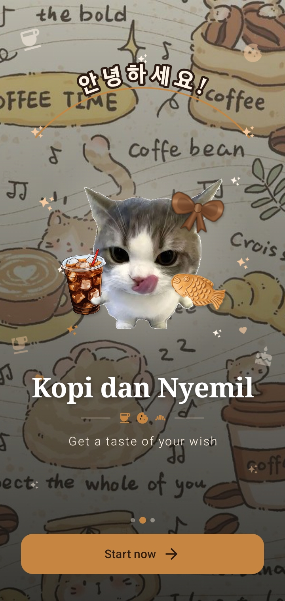 | 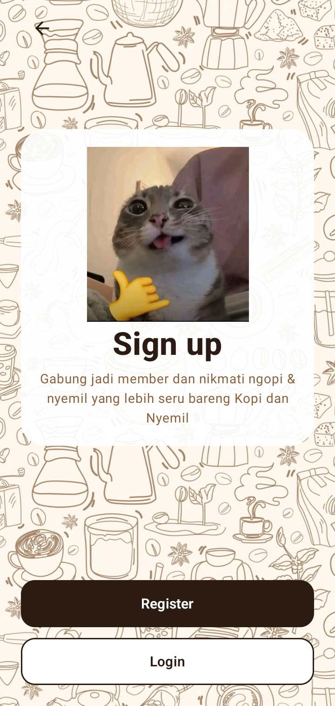 | 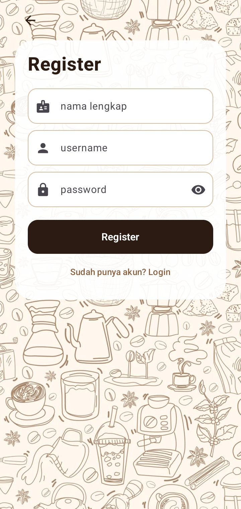 | 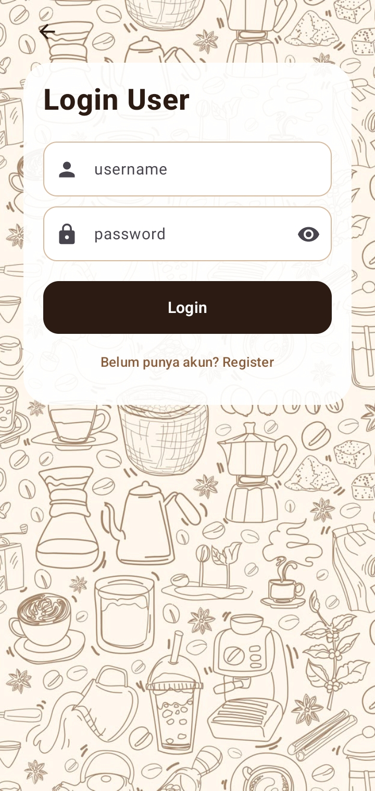 |

### Home

| Minuman (1) | Minuman (2) | Makanan (1) | Makanan (2) |
|:---:|:---:|:---:|:---:|
| 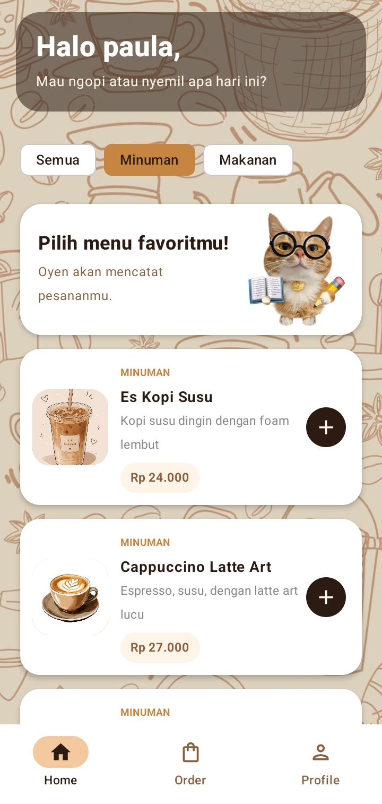 | 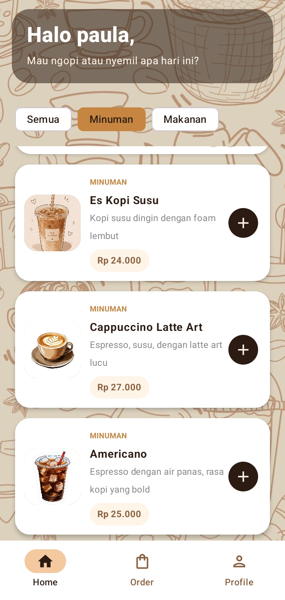 | 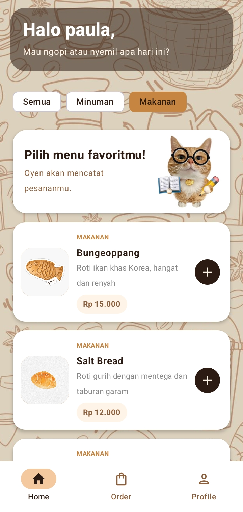 | 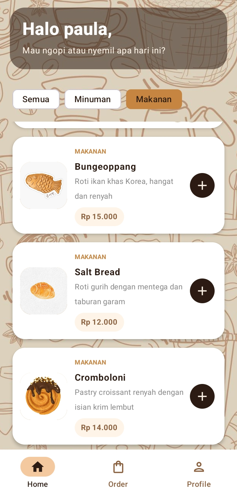 |

### Order dan Konfirmasi

| Order (keranjang) | Alamat (1) | Alamat (2) | Konfirmasi |
|:---:|:---:|:---:|:---:|
| 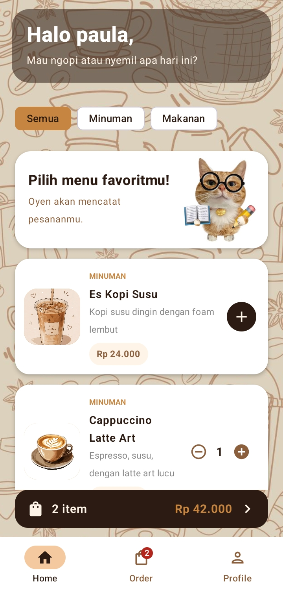 | 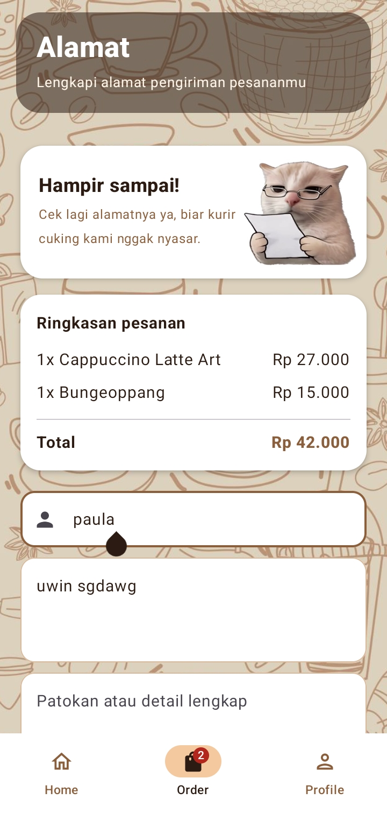 | 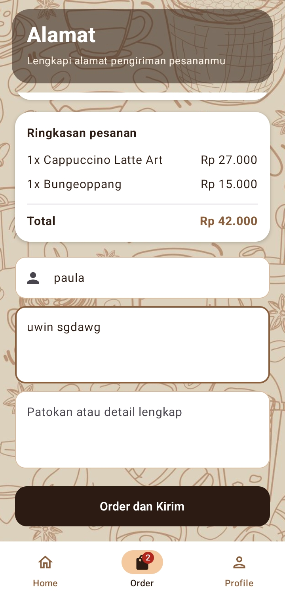 | 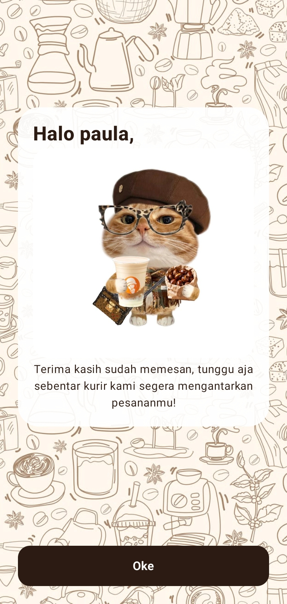 |

### Profile

| Profile |
|:---:|
| 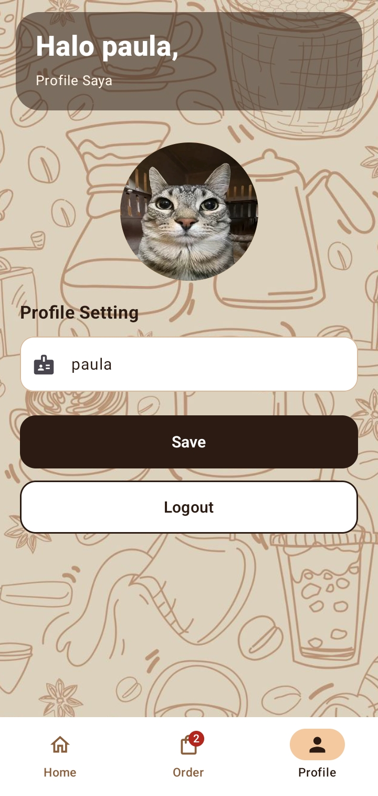 |

## Struktur Proyek

KopiDanNyemil-UTS/
├── app/
│   ├── build.gradle.kts
│   └── src/main/
│       ├── AndroidManifest.xml
│       ├── java/lat/pam/kopidannyemil/
│       │   ├── MainActivity.kt          # titik masuk aplikasi
│       │   ├── data/
│       │   │   └── AppState.kt          # menu dummy, akun, nama, dan keranjang
│       │   └── ui/
│       │       ├── AppNav.kt            # navigasi antar layar
│       │       ├── components/
│       │       │   ├── Common.kt        # tombol, kolom isian, toast
│       │       │   ├── MenuImage.kt     # foto menu
│       │       │   └── Wallpaper.kt     # latar, header, dan kartu
│       │       ├── screens/
│       │       │   ├── SplashScreen.kt        # 1. Splash / Welcome
│       │       │   ├── SignUpScreen.kt        # 2. Sign Up
│       │       │   ├── LoginScreen.kt         # 3. Login
│       │       │   ├── RegisterScreen.kt      # 4. Register
│       │       │   ├── MainScreen.kt          # bottom navigation
│       │       │   ├── HomeScreen.kt          # 5. Home (daftar menu)
│       │       │   ├── ProfileScreen.kt       # 6. Profile
│       │       │   ├── AddressScreen.kt       # 7. Alamat pengiriman
│       │       │   └── ConfirmationScreen.kt  # 8. Konfirmasi pesanan
│       │       └── theme/
│       │           ├── Color.kt, Theme.kt, Type.kt  # warna, tema, tipografi
│       └── res/
│           └── drawable/                # gambar: wallpaper, logo, foto menu, kucing
├── screenshots/                         # screenshot 8 layar untuk README
├── gradle/
├── build.gradle.kts
├── settings.gradle.kts
└── README.md

### Alur Navigasi

Splash → Sign Up → Register ┐
                  └─ Login ─┴→ Main (Home | Order | Profile) → Konfirmasi
